# SkillBridge AI

### Understand the role, explain your experience, and prepare for the interview

SkillBridge is a local web application that helps job seekers understand job requirements, compare their background with a role, improve the wording of their real experience, and prepare for interviews. This README connects the requirements, UML design, implementation, and verification developed for **SWE 401: Software Engineering**.

| Course information | Details |
| --- | --- |
| University | Abu Dhabi University |
| Department | CSIT, College of Engineering |
| Course | SWE 401: Software Engineering, Fall 2026 |
| Instructor | Dr. Murad Al-Rajab |
| Methodology | System Prototyping under Rapid Application Development (RAD) |
| Repository | [SWE401 Course Project Group 15](https://github.com/LeenMaharmaa/SWE401-CourseProject-Fall2026-Group15) |

| Team member | Student ID |
| --- | --- |
| Aisha Omar Qassem | 1099168 |
| Zeinab Ahmad Dardab | 1093356 |
| Leen Mohammed Maharma | 1098395 |

## Contents

1. [Problem and purpose](#problem-and-purpose)
2. [Main functionality](#main-functionality)
3. [Software engineering methodology](#software-engineering-methodology)
4. [Functional requirements](#functional-requirements)
5. [System context and use cases](#system-context-and-use-cases)
6. [Activity and sequence diagrams](#activity-and-sequence-diagrams)
7. [Class design](#class-design)
8. [Architecture and technology stack](#architecture-and-technology-stack)
9. [Interface screen tour](#interface-screen-tour)
10. [Database design](#database-design)
11. [Compatibility calculation](#compatibility-calculation)
12. [Installation and configuration](#installation-and-configuration)
13. [Run locally](#run-locally)
14. [Build and test](#build-and-test)
15. [Demonstration walkthrough](#demonstration-walkthrough)
16. [Collaborative development and attribution](#collaborative-development-and-attribution)
17. [Team responsibility plan](#team-responsibility-plan)
18. [Project structure and references](#project-structure-and-references)

## Problem and purpose

Job seekers can find it difficult to distinguish essential requirements from optional skills, understand technical terminology, and recognize how projects or previous work relate to a new role. Fresh graduates may have useful coursework but little professional experience. Career changers may have transferable skills that simple keyword matching overlooks.

SkillBridge brings these preparation tasks into one workspace. It makes the requirements clearer and helps users present their actual background accurately. Compatibility is explained as an estimate of fit, and experience suggestions remain subject to user review.

The primary actor is the **Job Seeker**, including fresh graduates, returning workers, and career changers. These categories share the main workflows. The external **AI/NLP Service** supports language tasks through the Gemini API.

## Main functionality

| Function | User input | Result |
| --- | --- | --- |
| Account and profile | Account details, consent, skills, qualifications, and experience | A saved profile and access to the workspace |
| Analyze Job Description | A description of up to 1,500 words | Required skills, nice to have skills, and terminology explanations |
| Calculate Compatibility Score | A saved analysis and profile | Percentage, matching and missing evidence, explanation, and disclaimer |
| Optimize Experience | Experience stored in the profile | Original and suggested wording, editing, and review confirmation |
| Practice Interview Questions | A selected or newly entered description | Questions, suggested answers, and quick reference notes |
| My History | A selected saved record | Reopening or deleting saved work |

**Complete profile → Analyze description → Review and save → Calculate compatibility → Generate interview preparation**

The selected role is carried between preparation screens. Experience optimization is independently available because it uses the user's profile.

## Software engineering methodology

The report selects **System Prototyping**, a RAD technique. Analysis, design, and implementation are refined through cycles of building, checking, and improving a working prototype.

| Phase | Engineering work | Output |
| --- | --- | --- |
| Planning | Define the problem, users, value, activities, and schedule | Proposal and management plan |
| Requirements | Analyze survey and interview findings | Functional and quality requirements and structured specifications |
| Analysis | Describe goals, workflows, responsibilities, and interactions | Use case, activity, class, and sequence diagrams |
| Design | Organize application layers, data, and interface | Architecture, database design, and screen layout |
| Implementation | Translate the design into code | Local application, SQLite storage, and Gemini integration |
| Verification and refinement | Check behavior and improve the prototype from feedback | Focused tests, workflow checks, clearer results, and visible next actions |

Traceability follows **requirement → use case → diagram → implementation → verification**. For example, FR-18 appears in UC-01, its activity and sequence diagrams, and the prepared explanations displayed by the analysis screen.

## Functional requirements

This table describes the current implemented requirement wording. The password minimum is six characters. Compatibility is separately requested after analysis. Interview preparation includes suggested answers and notes without evaluating user answers.

| ID | Functional requirement | Demonstrated in |
| --- | --- | --- |
| FR-01 | Obtain consent before account creation | Signup checkbox |
| FR-02 | Validate basic account details, reject duplicate emails, and report incorrect credentials; minimum password length is six characters | Signup and signin |
| FR-03 | Allow signin with valid credentials | Signin screen |
| FR-04 | Allow sign out and return to account access | Sign out control |
| FR-05 | Restrict protected functions and records to the signed in account | Profile, preparation functions, and history |
| FR-06 | Display the four main preparation tasks | Overview and navigation |
| FR-07 | Accept pasted descriptions and reject empty input | Description forms |
| FR-08 | Reject descriptions longer than 1,500 words | Word counter and validation |
| FR-09 | Save skills, qualifications, and experience; identify missing required information | My profile and UC-01 entry check |
| FR-10 | Extract required and nice to have skills | Analysis results |
| FR-11 | Compare evidence, calculate compatibility, explain it, and display a disclaimer | Compatibility results |
| FR-12 | Present analysis and compatibility in clearly identified groups | Required Skills, Nice to Have, Matching Skills, Missing Evidence, and explanation |
| FR-13 | Restrict experience optimization to saved background | Experience generation and source checks |
| FR-14 | Generate questions, suggested answers, and quick reference notes together | Interview preparation |
| FR-15 | Report service failures and provide recovery | Error messages, retry controls, and diagnostic logs |
| FR-16 | Save descriptions and analyses; provide history, deletion, and empty states | My history |
| FR-17 | Extract requirements without automatically calculating compatibility | UC-01 |
| FR-18 | Reveal prepared terminology explanations on hover, focus, or selection | Highlighted terms |
| FR-19 | Allow editing of suggested experience | Suggested text area |
| FR-20 | Show original and suggested experience together | Side by side experience view |
| FR-21 | Require review confirmation before acceptance | Review checkbox |
| FR-22 | Calculate compatibility for a selected saved analysis and retain results | Calculate compatibility and My history |

Input and response checks, source grounding, explained scores, and record ownership support the quality requirements. Response time and usability thresholds in the report remain evaluation targets; focused checks do not establish statistical compliance with those targets.

### Quality requirements

| ID | Target or constraint from the requirements |
| --- | --- |
| NFR-01 | Analysis and compatibility target a response within 20 seconds for at least 95% of requests |
| NFR-02 | Experience suggestions and interview preparation target a response within 15 seconds for at least 95% of requests |
| NFR-03 | At least four of five first time users complete each main task without assistance |
| NFR-04 | At least 80% of evaluated users report that results are easy to understand |
| NFR-05 | Invalid input and service failures produce understandable messages while the application remains operational |
| NFR-06 | Experience suggestions introduce no unsupported skills or qualifications in predefined profile checks |
| NFR-07 | Matching considers technical skills, soft skills, and transferable experience and explains the estimate |
| NFR-8 | Users cannot access another account's personal or career records |
| NFR-9 | Collect only information needed for the preparation services |
| NFR-10 | Allow users to view and delete saved data and explain its service related use |
| NFR-11 | Support current Chrome, Edge, and Safari on desktop screens at least 1366 pixels wide |

The focused browser walkthrough used Chromium. Independent Edge/Safari checks and the report's statistical timing and user studies are separate from the verification reported below.

## System context and use cases

### System context

SkillBridge coordinates tasks and stores results. Gemini returns structured analysis and comparison factors. **SkillBridge calculates the final percentage.**

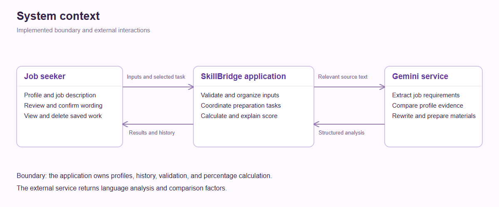

[Open full size](implementation/docs/diagrams/context.png) · [Diagram source](implementation/docs/diagrams/sources/context.svg)

### Use case diagram

Analysis includes entering the description and extracting skills. Compatibility is a separate request. Original and suggested wording are compared during experience optimization.

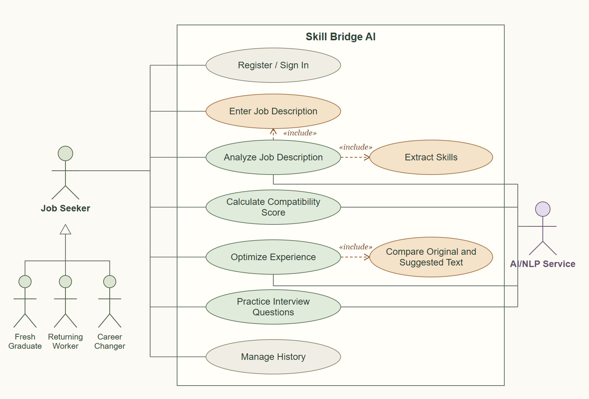

[Open full size](implementation/docs/diagrams/use-case.png) · [Interactive diagram](implementation/docs/diagrams/sources/use-case.html)

| Detailed use case | Trigger | Successful outcome |
| --- | --- | --- |
| UC-01: Analyze Job Description | Submit a description after completing the profile | Requirements and explanations displayed and saved after review |
| UC-02: Calculate Compatibility Score | Request compatibility for a saved analysis | Comparison returned; percentage calculated, displayed, and saved |
| UC-03: Practice Interview Questions | Select or submit a valid description | Questions, suggested answers, and notes displayed for independent preparation |

## Activity and sequence diagrams

Activity diagrams show workflows, decisions, and recovery paths. Sequence diagrams show collaboration between the page, controller responsibilities, domain records, and external service. Expand the figures or open their full resolution images.

### UC-01 Analyze Job Description

**Requirements:** FR-07 to FR-10, FR-15 to FR-18.

Check profile completeness, validate the description, request analysis, display requirements and prepared explanations, and save after review. Viewing an explanation requires no additional model call. **Save and calculate compatibility** saves the reviewed analysis before starting UC-02.

<details>
<summary>Activity diagram for UC-01</summary>

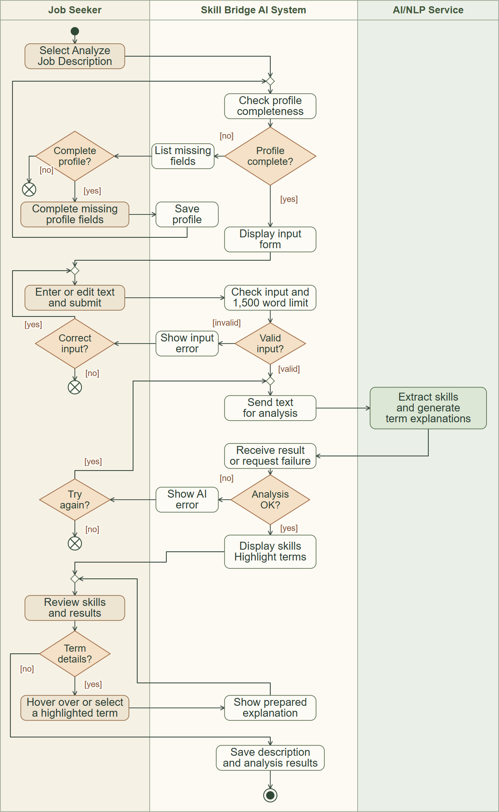

[Open full size](implementation/docs/diagrams/activity-uc01.png) · [Interactive source](implementation/docs/diagrams/sources/activity-uc01.html)

</details>

<details>
<summary>Sequence diagram for UC-01</summary>

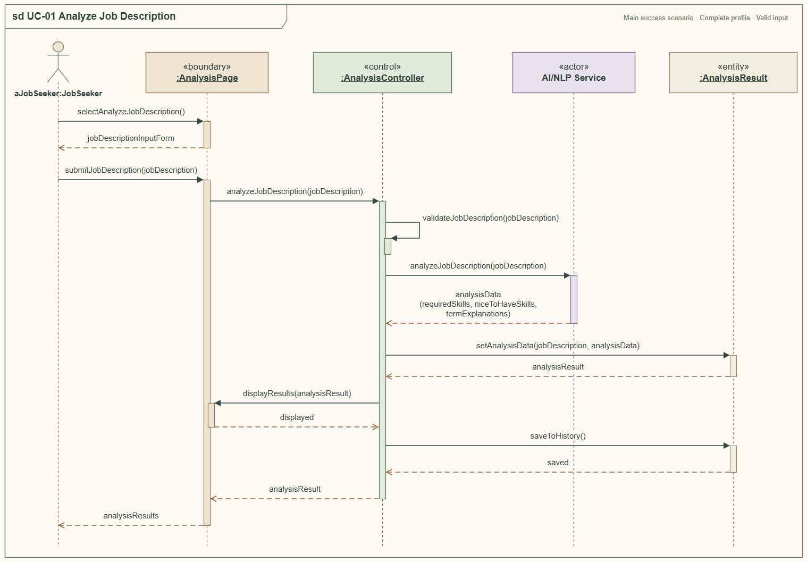

[Open full size](implementation/docs/diagrams/sequence-uc01.png) · [Editable source](implementation/docs/diagrams/sources/sequence-uc01.drawio)

</details>

### UC-02 Calculate Compatibility Score

**Requirements:** FR-11, FR-12, FR-15, FR-16, FR-22.

Retrieve saved requirements and profile information. Gemini compares the evidence; SkillBridge calculates the percentage and explanation. Display the result and disclaimer, then save. Calculation and saving retries reuse existing comparison data.

<details>
<summary>Activity diagram for UC-02</summary>

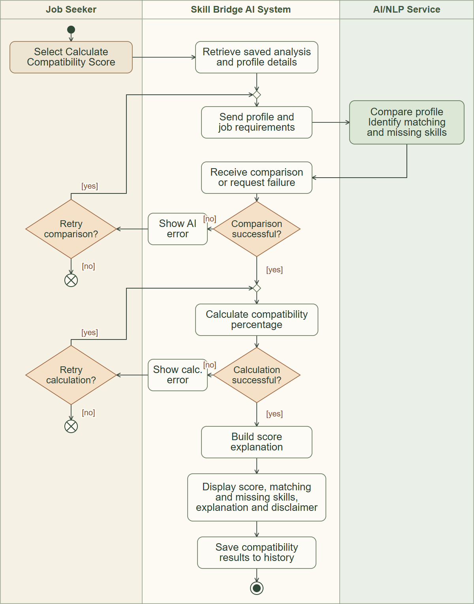

[Open full size](implementation/docs/diagrams/activity-uc02.png) · [Interactive source](implementation/docs/diagrams/sources/activity-uc02.html)

</details>

<details>
<summary>Sequence diagram for UC-02</summary>

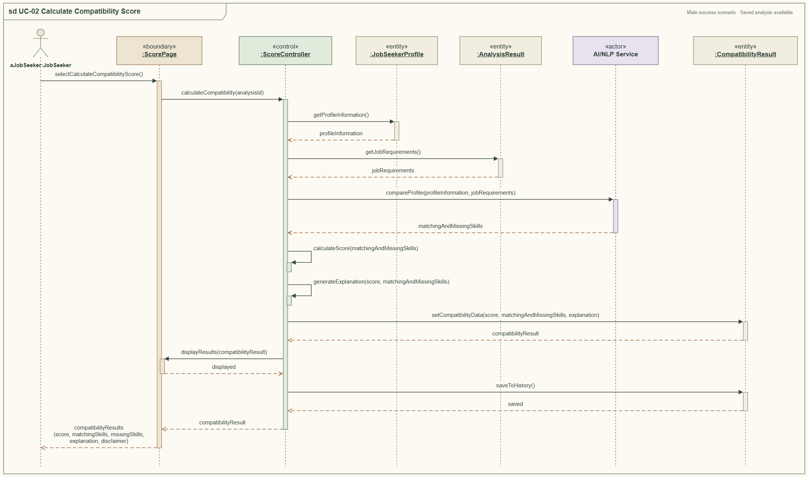

[Open full size](implementation/docs/diagrams/sequence-uc02.png) · [Editable source](implementation/docs/diagrams/sources/sequence-uc02.drawio)

</details>

### UC-03 Practice Interview Questions

**Requirements:** FR-07, FR-08, FR-14, FR-15.

Select a description or submit a valid new one. One request returns questions, corresponding suggested answers, and notes. The user reviews the materials and practices independently. Answer submission and evaluation are outside this use case.

<details>
<summary>Activity diagram for UC-03</summary>

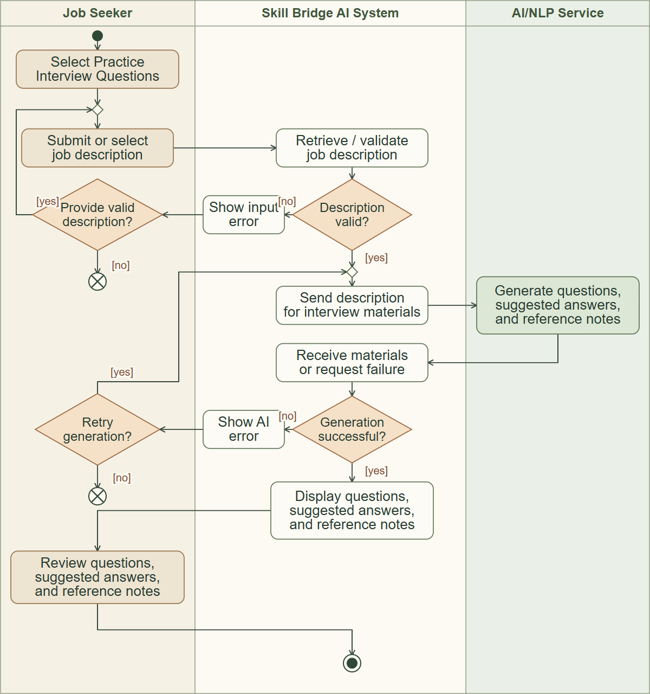

[Open full size](implementation/docs/diagrams/activity-uc03.png) · [Interactive source](implementation/docs/diagrams/sources/activity-uc03.html)

</details>

<details>
<summary>Sequence diagram for UC-03</summary>

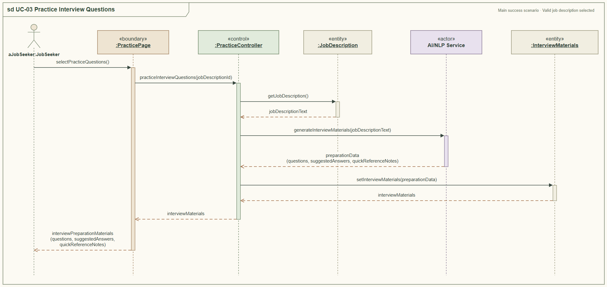

[Open full size](implementation/docs/diagrams/sequence-uc03.png) · [Editable source](implementation/docs/diagrams/sources/sequence-uc03.drawio)

</details>

### Structured specifications

| Specification | Requirement | Implemented behavior |
| --- | --- | --- |
| SPEC-01 | FR-09 | Show profile fields, validate required information, and save |
| SPEC-02 | FR-11 | Compare saved inputs on request, calculate and explain compatibility, and show the disclaimer |
| SPEC-03 | FR-14 | Generate questions, suggested answers, and notes together |

## Class design

The model separates **boundary** objects, **control** responsibilities, **entities**, and the external service. AnalysisResult and CompatibilityResult are separate because extraction and compatibility calculation are separate operations.

<details>
<summary>Complete class diagram</summary>

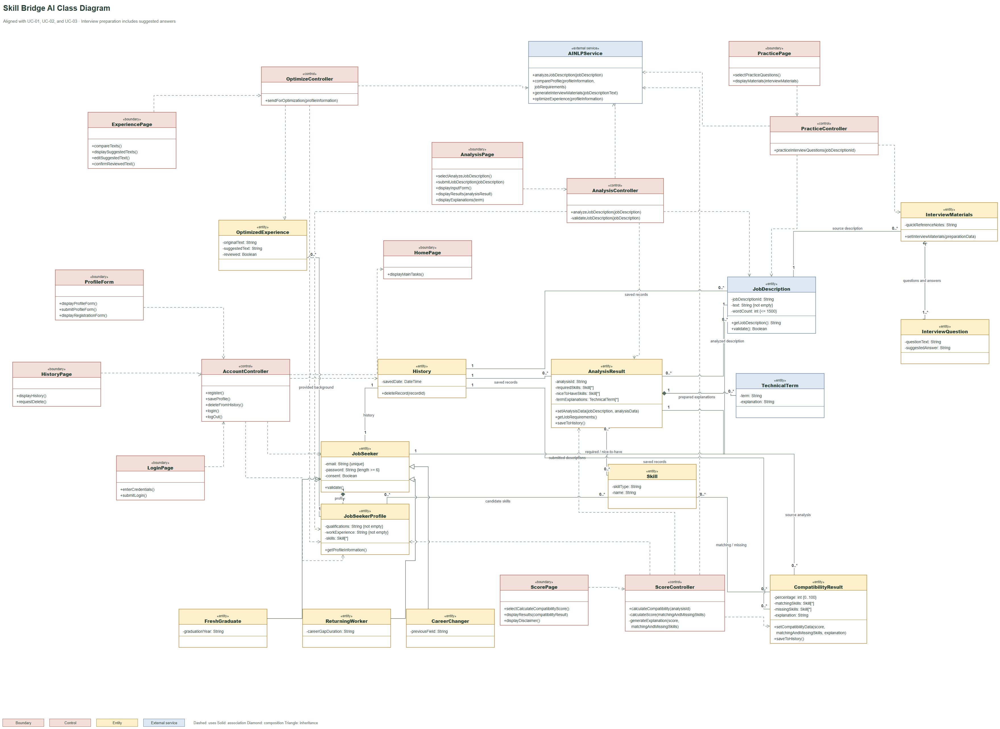

[Open full size](implementation/docs/diagrams/class.png) · [Editable source](implementation/docs/diagrams/sources/class.drawio)

</details>

The published class diagram uses the current six-character password constraint. The implementation represents model responsibilities using React components, TypeScript types, server functions, and database records.

| Design element | Implementation responsibility |
| --- | --- |
| AnalysisPage and AnalysisController | Input, analysis, display, explanations, and saving |
| ScorePage and ScoreController | Comparison, local calculation, explanation, display, and saving |
| ExperiencePage and OptimizeController | Suggestions, editing, comparison, and review confirmation |
| PracticePage and PracticeController | Description retrieval and preparation generation |
| JobSeeker and JobSeekerProfile | Separate account and profile records |
| AnalysisResult, CompatibilityResult, and InterviewMaterials | Structured results linked to their source records |
| TechnicalTerm and InterviewQuestion | Explanations and question/answer data within an owning result |
| HistoryPage and History | Saved record access and deletion |

## Architecture and technology stack

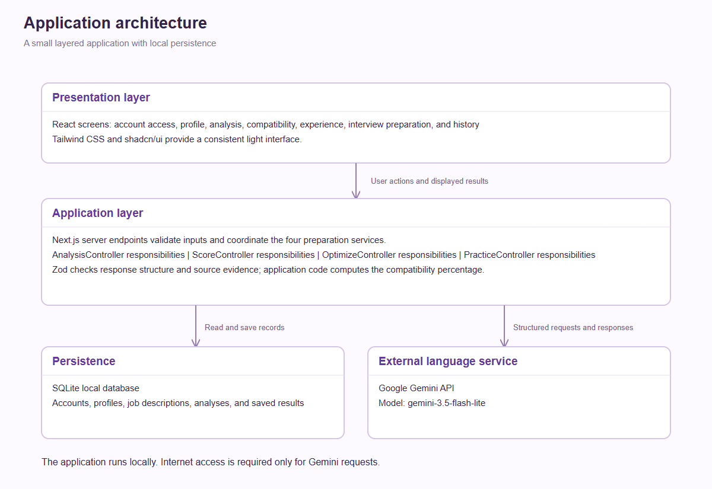

[Open full size](implementation/docs/diagrams/architecture.png) · [Diagram source](implementation/docs/diagrams/sources/architecture.svg)

| Layer or concern | Technology | Purpose |
| --- | --- | --- |
| Application | Next.js 16 and React 19 | Screens and server endpoints in one project |
| Language | TypeScript | Shared types and static checking |
| Interface | Tailwind CSS, shadcn/ui, and Lucide icons | Light purple theme and consistent controls |
| Persistence | SQLite through Node's built in SQLite module | Local storage without a database server |
| Language tasks | Google GenAI SDK and Gemini 3.5 Flash-Lite | Extraction, evidence comparison, wording, and preparation |
| Validation | Zod | Input checks and structured response validation |
| Verification | Node test runner through tsx; Playwright browser checks | Logic checks and application walkthroughs |

The API key stays in server side configuration. Extracted requirements include source references, and comparison evidence is checked against the profile. The application owns validation, storage, score calculation, and presentation.

## Interface screen tour

These eight captures show the implemented interface. Expand a screen to inspect its controls and output layout.

<details>
<summary>Account creation</summary>

The registration form groups name, email, password, and consent controls.

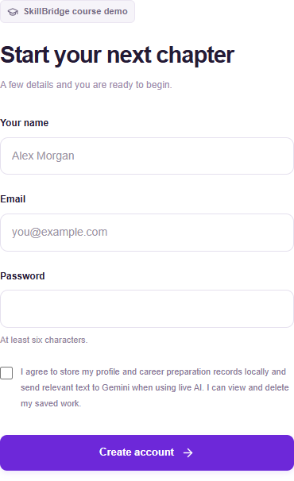

[Open full size](implementation/docs/screens/account.png)

</details>

<details>
<summary>Overview</summary>

The sidebar and four task cards provide entry points to the preparation functions.

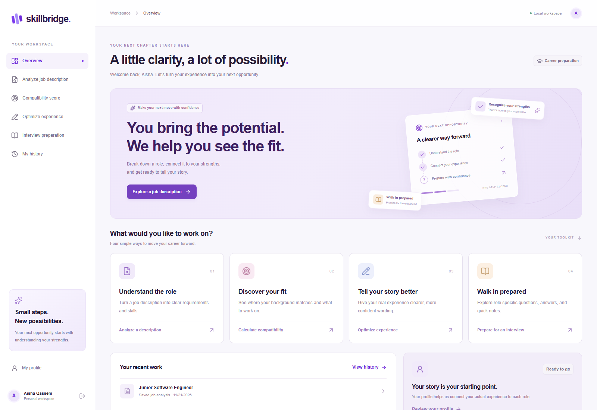

[Open full size](implementation/docs/screens/overview.png)

</details>

<details>
<summary>Profile fields</summary>

Skills, qualifications, and experience form the evidence used by comparison and optimization.

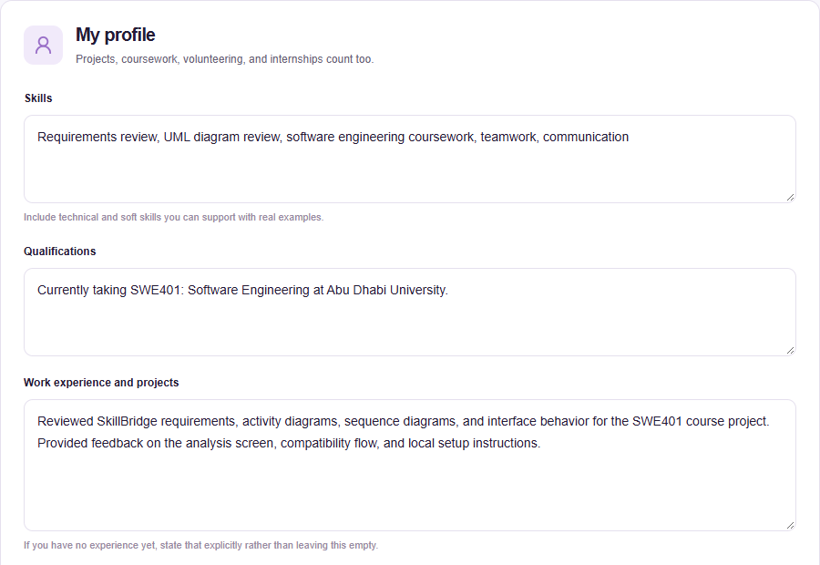

[Open full size](implementation/docs/screens/profile.png)

</details>

<details>
<summary>Job analysis</summary>

Required and optional requirements, highlighted terminology, and the visible next action organize the result.

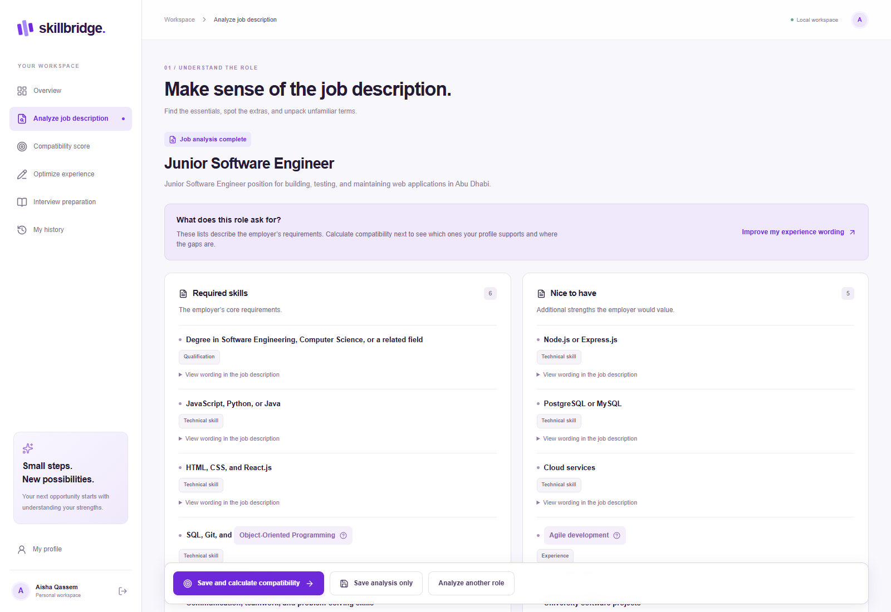

[Open full size](implementation/docs/screens/analysis.png)

</details>

<details>
<summary>Compatibility result</summary>

The score indicator, evidence groups, explanation, and disclaimer make the calculation inspectable.

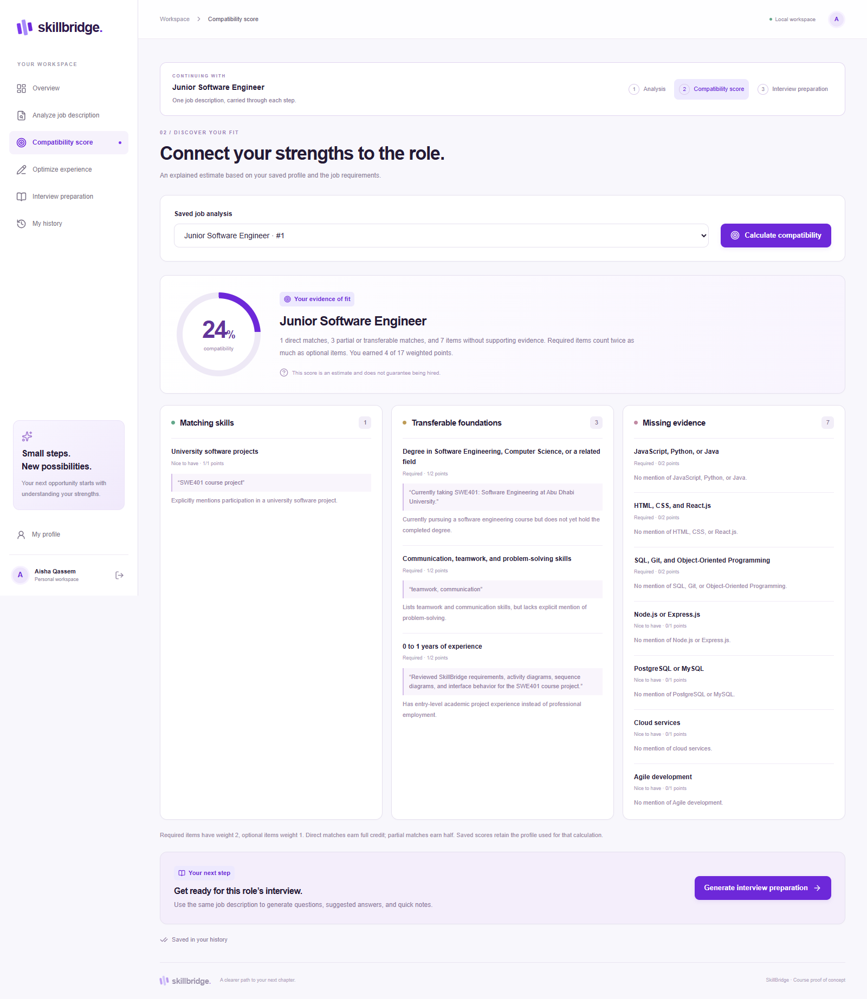

[Open full size](implementation/docs/screens/compatibility.png)

</details>

<details>
<summary>Experience optimization</summary>

Original wording and the editable suggestion are displayed together, followed by review confirmation.

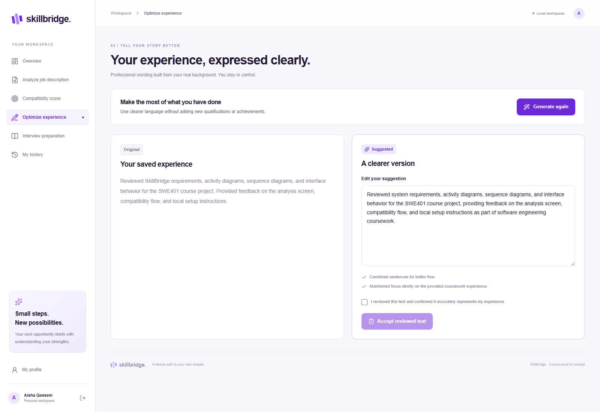

[Open full size](implementation/docs/screens/experience.png)

</details>

<details>
<summary>Interview preparation</summary>

Expandable question cards show suggested answers beside quick reference notes.

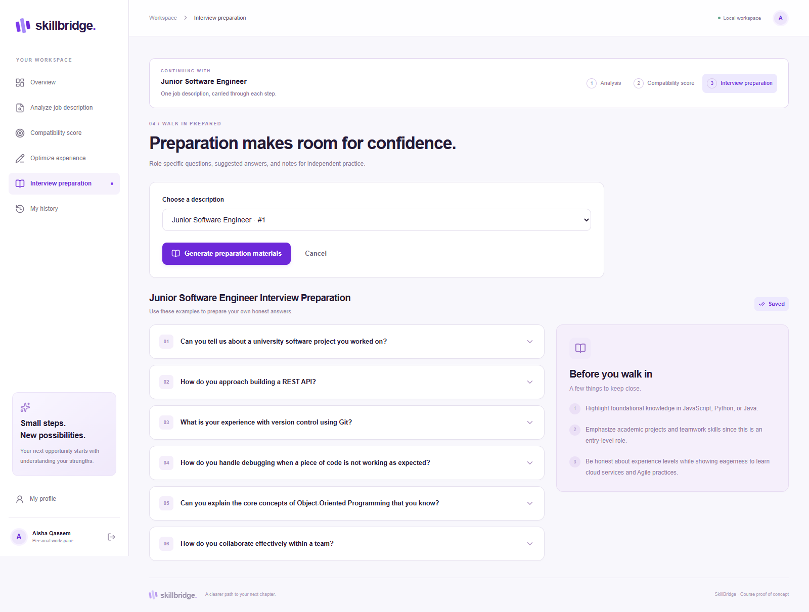

[Open full size](implementation/docs/screens/interview.png)

</details>

<details>
<summary>Saved history</summary>

Category tabs, record opening, and deletion controls support management of saved work.

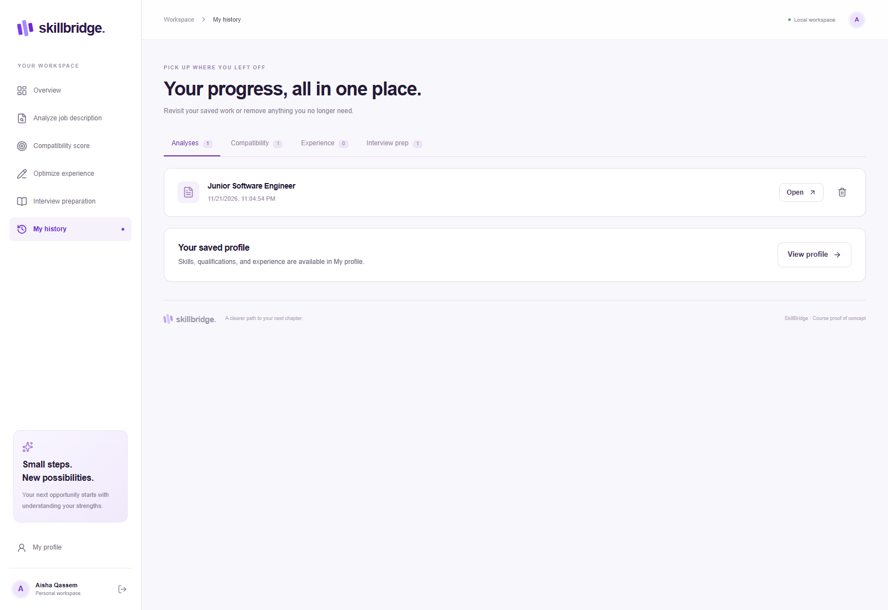

[Open full size](implementation/docs/screens/history.png)

</details>

## Database design

SQLite automatically creates `data/skillbridge.db`. Foreign keys preserve associations. Generated collections are stored as validated JSON inside their owning records.

<details>
<summary>Database tables and main relationships</summary>

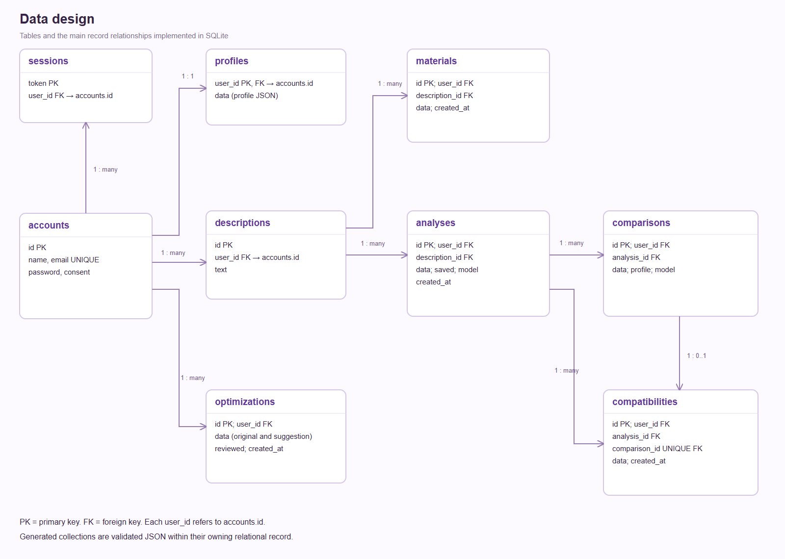

[Open full size](implementation/docs/diagrams/database.png) · [Diagram source](implementation/docs/diagrams/sources/database.svg)

</details>

| Table | Primary key | Important columns and relationships |
| --- | --- | --- |
| `accounts` | `id` | `name`, unique `email`, password hash, `consent` |
| `profiles` | `user_id` | One profile per account; `data` holds skills, qualifications, and experience |
| `sessions` | `token` | `user_id` associates account access with the signed in user |
| `descriptions` | `id` | `user_id`, submitted `text` |
| `analyses` | `id` | `user_id`, `description_id`, `data`, `saved`, `model`, `created_at` |
| `comparisons` | `id` | `user_id`, `analysis_id`, `data`, profile snapshot, `model` |
| `compatibilities` | `id` | `user_id`, `analysis_id`, unique `comparison_id`, `data`, `created_at` |
| `optimizations` | `id` | `user_id`, original and suggested text in `data`, `reviewed`, `created_at` |
| `materials` | `id` | `user_id`, `description_id`, preparation `data`, `created_at` |

Deleting an analysis removes its dependent comparisons and compatibility results. Descriptions remain while another saved record needs them. Existing scores retain the profile used for that calculation; recalculation uses the latest saved profile.

To inspect the database, open `data/skillbridge.db` with **SQLite Viewer** in VS Code. If necessary, choose **Reopen Editor With → SQLite Viewer**. Refresh after changing records. The application handles table creation and record updates.

## Compatibility calculation

Gemini classifies each extracted item using profile evidence. SkillBridge then applies a deterministic formula.

| Factor | Value |
| --- | ---: |
| Required item weight | 2 |
| Nice to have item weight | 1 |
| Direct match credit | 1 |
| Partial or transferable match credit | 0.5 |
| No supporting evidence credit | 0 |

```text
Earned points = sum of item weight × match credit
Available points = sum of item weights
Compatibility = round(100 × earned points / available points)
```

Every requirement must have a comparison entry. Duplicate names are consolidated. The explanation uses the same factors as the percentage. No score is calculated without usable requirements.

The result displays: **“This score is an estimate and does not guarantee being hired.”**

## Installation and configuration

### Prerequisites

* Node.js **24 or later**, with npm.
* A Gemini API key and internet access for language generation.
* A modern desktop browser. VS Code is recommended for running the app and viewing SQLite.

### Install dependencies

Open the project folder in VS Code, then choose **Terminal → New Terminal**:

```powershell
cd implementation
npm install
```

### Configure Gemini

1. Open [Google AI Studio API Keys](https://aistudio.google.com/apikey) and sign in.
2. Copy an existing key, or choose **Create API key** and follow Google's project selection instructions.
3. Create the local configuration file once:

   ```powershell
   Copy-Item .env.example .env.local
   ```

4. Open `.env.local` and enter:

   ```dotenv
   GEMINI_API_KEY=your_actual_api_key
   GEMINI_MODEL=gemini-3.5-flash-lite
   ```

5. Save and restart the app. If `.env.local` already exists, edit it instead of overwriting it.

The model is selected when sending a request, not when creating the key. Availability and quota depend on the Google project. Local configuration, database files, and logs are excluded from version control.

## Run locally

From the application folder:

```powershell
npm run dev
```

Open **[http://localhost:3000](http://localhost:3000)**. Create an account, accept the consent notice, sign in, and complete the profile. Email must contain `@`; passwords require at least six characters. Stop with `Ctrl+C`.

The database is created automatically. No Docker, hosting, or separate database service is required. The application and records remain local; relevant text is sent to Gemini for the requested language tasks.

## Build and test

Stop the development server before creating a production build:

```powershell
npm run typecheck
npm test
npm run build
npm start
```

Open [localhost:3000](http://localhost:3000) to check the built application. Type checking verifies TypeScript, tests verify selected behavior, and the build prepares the production application.

| Verification | Expected result | Observed result |
| --- | --- | --- |
| Description validation | Reject empty input and more than 1,500 words; accept exactly 1,500 | Passed |
| Scoring | Correct weights, partial credit, rounding, and incomplete input handling | Passed |
| Response grounding | Reject invalid structures and unsupported references | Passed |
| Database | Persist records, enforce ownership, and delete dependent records | Passed |
| Error logging | Keep provider details while removing keys | Passed |
| Browser workflow | Save analysis, calculate compatibility, reopen history, and continue to interview preparation | Passed with controlled inputs |
| Live service integration | Accept structured output for all four language tasks | Successful point checks; temporary provider errors were also observed |

The focused automated run completed **7 tests with 0 failures**. These checks verify selected cases, not statistical performance or usability targets from the report.

If generation fails, inspect the terminal or `logs/ai.log`. Temporary 503 responses are retried once. Timeouts and quota failures do not start another long automatic attempt. To watch logs from a second terminal:

```powershell
Get-Content .\logs\ai.log -Tail 20 -Wait
```

## Demonstration walkthrough

| Step | Action | Engineering point |
| --- | --- | --- |
| 1 | Create an account and complete the profile | Required inputs and persistence |
| 2 | Paste and analyze a description | Validation and required versus optional extraction |
| 3 | Select a highlighted term | Prepared explanations reused without another request |
| 4 | Choose **Save and calculate compatibility** | UC-01 saves before separately requested UC-02 |
| 5 | Explain the score, evidence, gaps, and disclaimer | Transparent calculation and traceability |
| 6 | Choose **Generate interview preparation** | The same description continues into UC-03 |
| 7 | Open **Optimize experience**, edit, confirm review, and accept | User control over truthful wording |
| 8 | Reopen and delete a history record | Retrieval and dependent record handling |

## Collaborative development and attribution

Aisha Omar Qassem, Leen Mohammed Maharma, and Zeinab Ahmad Dardab developed this project collaboratively using one shared workstation. The completed implementation is being imported into the team repository after that shared development work.

The existing repository history is retained. The publication commit credits the participating team members using their GitHub-associated identities. It records the completed project import, rather than reconstructing historical development dates or assigning earlier work to invented individual commits. Co-authorship credits participation in the shared work; it does not assert equal quantities of code or sole ownership of particular files.

The responsibility table below is the team's planning allocation. It is not a retrospective measurement of individual contributions or evidence that each listed task was performed independently.

## Team responsibility plan

This is a proposed equal workload allocation for completion, review, and presentation. Each member has feature, design, verification, and documentation responsibilities. Record actual contributions through each member's own commits and the final report.

| Work area | Aisha | Zeinab | Leen |
| --- | --- | --- | --- |
| Requirements and design | Profile and analysis requirements; UC-01 and use case review | Compatibility and history requirements; UC-02, class relationships, and data design | Experience and interview requirements; UC-03 and interface consistency |
| Implementation review and completion | Accounts, profile, job analysis, and terminology interactions | Database, compatibility calculation, and history | Language task integration, experience editing, and interview preparation |
| Verification | Account/profile walkthrough and description boundary checks | Score arithmetic, persistence, and deletion | Generation failure recovery, review confirmation, and interview output |
| Documentation | Problem, requirements, and methodology | Architecture, class model, data design, and scoring | Installation, configuration, running, and demonstration instructions |
| Presentation | Problem, profile, and analysis | Design, compatibility, and history | Experience optimization, interview preparation, setup, and tests |
| Workload target | One third | One third | One third |

All three members should review and rehearse the full workflow and explain how the requirements connect to implementation. Rotate the coordination role between review cycles, consistent with the management guidance.

## Project structure and references

```text
implementation/
  README.md
  .env.example
  src/
    app/                  Screens, layout, styling, and server endpoints
    components/           Workspace and reusable controls
    lib/                  Data access, language tasks, validation, scoring, and logs
  tests/                  Focused automated checks
  docs/
    diagrams/             Screenshots and editable diagram sources
    screens/              Interface captures
  data/                   SQLite file, created at runtime
  logs/                   Diagnostics, created at runtime
```

The published diagrams follow the revised UC-01, UC-02, and UC-03 flows. Context and architecture views describe the implemented boundary. The class diagram copy applies the approved six-character password rule. Earlier course reports and original diagrams remain preserved in the project folders.

References: the project's SWE401 Phase 2 report, current UML artifacts, and *SWE 401 Course Project Fall 2026* rubric; [Next.js documentation](https://nextjs.org/docs), [SQLite documentation](https://www.sqlite.org/docs.html), and [Gemini API documentation](https://aistudio.google.com/docs).
