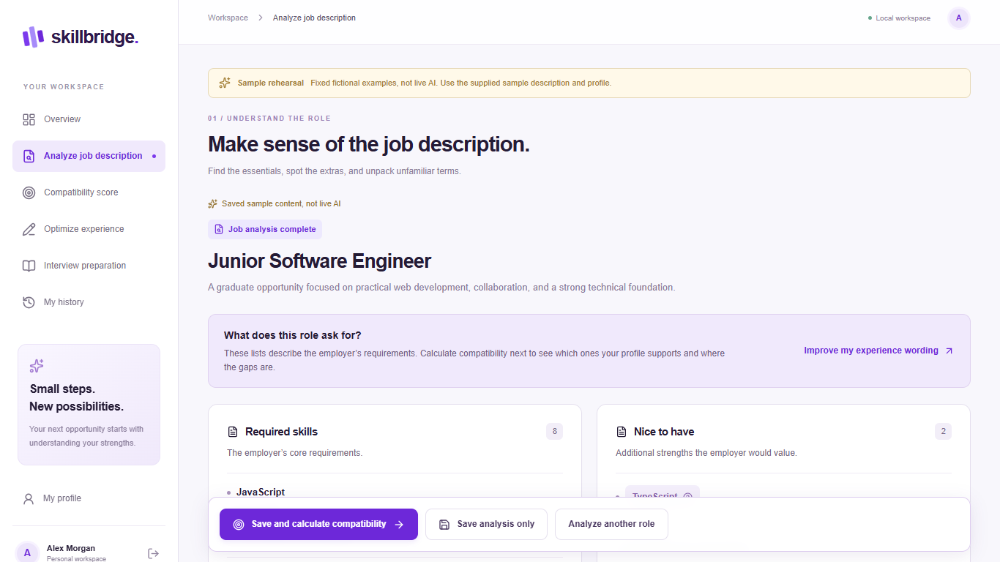
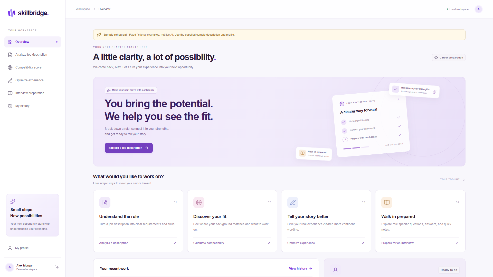
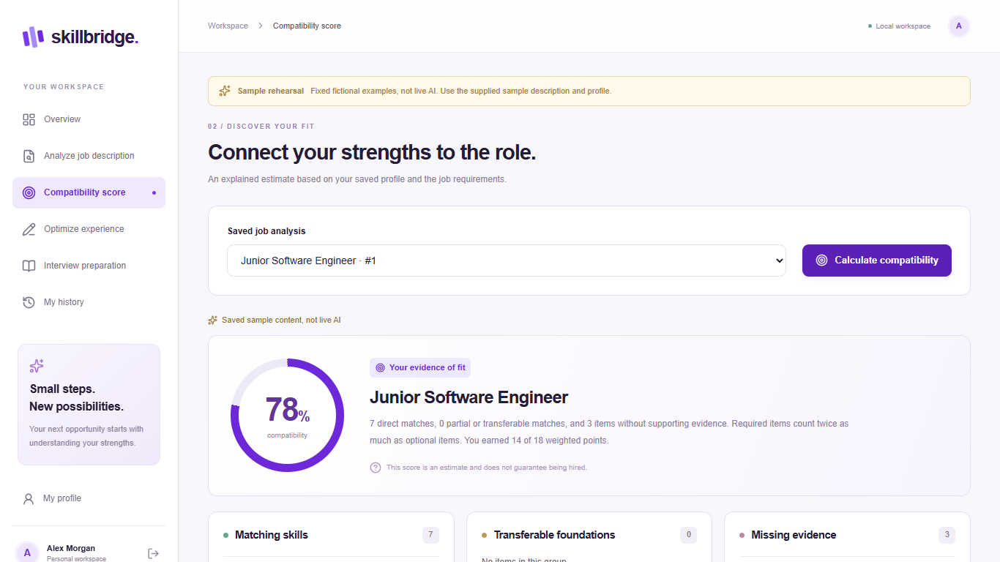
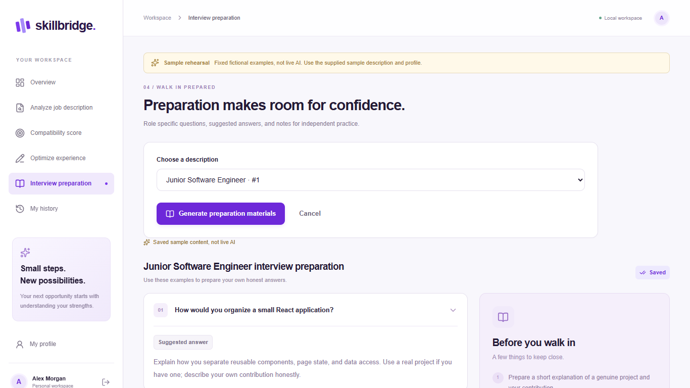
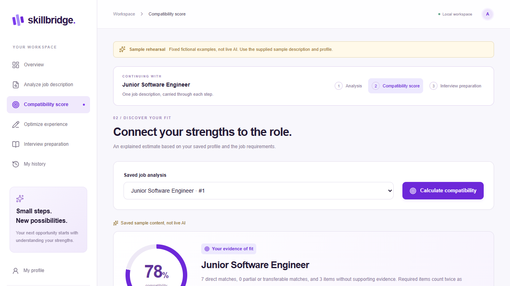

# SkillBridge test evidence

## Analysis result clarity check

The analysis screen now explains that its lists describe the employer's requirements. Neutral bullets replace match-like check marks, source quotations are expandable, and a floating Save and calculate compatibility action stays visible. A direct link opens experience optimization. TypeScript checking and all seven focused tests passed. A separate sample-mode browser check at 1366 by 768 verified the visible action, collapsed quotations, optimizer navigation, saving before comparison, and successful score display. The browser console reported no errors.

Checked November 21, 2026 on Windows with Node.js 24.5.0. Automated database checks used temporary files, and browser checks used a separate QA database. The normal application database was not filled with test accounts or records.

## Build and automated checks

| Check | Expected | Actual |
| --- | --- | --- |
| `npm run typecheck` | No TypeScript errors | Passed |
| `npm test` | All focused tests pass | 6 passed, 0 failed |
| `npm run build` | Production build completes | Passed with Next.js 16.4.6 |
| Description boundaries | Empty and 1,501 words rejected; 1,500 accepted | Passed |
| Weighted score | Correct required weights, partial credit, rounding, and empty input handling | Passed; sample result 78% |
| Response validation | Invalid structures and unsupported source quotes rejected | Passed |
| Database | Drafts excluded from history; saved records persist; ownership enforced; deletion cascades | Passed |

## Local browser and server checks

Playwright used Chromium at 1366 × 768 and 1920 × 1080. Generated content checks used the explicitly labelled sample rehearsal, not live Gemini.

| Scenario | Expected | Actual |
| --- | --- | --- |
| Basic signup and signin | Email containing `@` and a six character password work | Passed using a separate test account |
| Incomplete profile | Analysis requests ask for missing information | Passed |
| Analysis | Required and optional groups appear; review precedes history saving | Passed |
| Term explanations | Hover, focus, and click reveal prepared content without another request | Passed; zero API requests during interaction |
| Simulated AI failure | Error appears; retry can succeed | Passed |
| Compatibility | Compare, calculate locally, display 78%, disclaimer, then save | Passed |
| Simulated score save failure | Keep result visible; retry saving without another comparison | Passed; no repeat comparison request |
| Experience | Show both versions; require review before acceptance | Passed; acceptance initially disabled, then accepted and saved |
| Interview preparation | Questions, suggested answers, and notes displayed together | Passed; six questions; first answer expanded |
| History | Reopen score and retain all categories after refresh | Passed |
| Deletion | Delete analysis and its dependent score, retain independent interview materials | Passed |
| Production restart | Saved profile and all four history categories remain available | Passed after stopping development server and starting the production build |
| Live mode without a key | Clear setup message instead of substituted AI output | Passed |
| Desktop layout | Readable layout without horizontal overflow at both target sizes | Passed and visually inspected |
| Final production browser check | Signup works with the simple rules and no browser console errors | Passed at localhost; 0 errors and 0 warnings |

Browser testing found and corrected a hover issue with terminology explanations. A development rebuild loop was also removed by restricting Tailwind's source scanning to application code.

## Screenshots

These screenshots show the labelled fictional sample rehearsal.

## Role continuation follow up

After adding the contextual role steps, the production build, TypeScript check, and all six focused tests passed again. A separate browser check verified one description flowing directly from analysis to compatibility and interview generation, with one request per operation and the same analysis identifier throughout. Navigating the three step bar reused existing results without new generation requests. Reopening a saved score preserved its source role. A second analysis also carried its own identifier through both operations rather than reusing the first role. The browser console reported zero errors and warnings.

## Remaining live verification

Live Gemini requests, actual free quota, and model output quality are pending the user's API key. SDK integration compiles, but compilation and fixture checks do not establish live model quality. The course report's statistical response time and usability targets were not measured. Safari and Edge were not independently tested.

The focused checks support the demonstration workflows; they are not a claim that every possible input or environment is error free.

## Live timeout investigation

After the key was configured, Google's model listing returned HTTP 200 and included the configured model. A short generation reproduced the original 30 second abort. The application timeout was increased to 90 seconds and thinking effort reduced, but a subsequent live generation still timed out. A separate diagnostic request using Gemini 3.8 Flash returned Google's HTTP 504 DEADLINE_EXCEEDED after approximately 89 seconds. At that stage live generation had not passed. The selected model setting was not changed by that diagnostic. TypeScript checking and all six focused tests passed after the initial timeout adjustment.

## Live alternative model checks

A subsequent minimal Hydrogen request returned HTTP 503 with Google's explicit high demand message. The configured model was then changed to Gemini 3.5 Flash-Lite after these successful live checks:

| Operation | Observed result |
| --- | --- |
| Shorter supplied job description | Completed in approximately 2.8 seconds and passed structural and source checks |
| Longer supplied description, with presentation markup removed | Completed in approximately 3.2 seconds; 9 required and 5 optional items |
| Comparison with the fictional sample profile | All 14 extracted items compared, evidence validated, and percentage calculated locally; one transient 503 before successful retry |
| Experience optimization | Completed in approximately 1.7 seconds with valid supporting profile quotes |
| Interview preparation | A sample role generated 6 questions, corresponding suggested answers, and 3 notes in approximately 2.7 seconds |

Some Flash-Lite requests also returned temporary 503 errors. The application now permits one brief retry for 503 responses only. These successful point checks establish live integration for the tested cases, not guaranteed service availability or the report's statistical performance targets. The user's API key was preserved.
